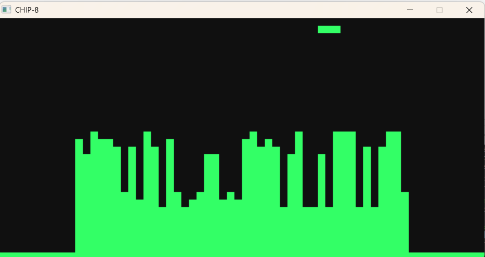

# CHIP-8 Emulator

A CHIP-8 interpreter written in C++17 with SDL2. It runs classic CHIP-8 games such as Pong, Tetris and Space Invaders.



## Features

- All 35 standard CHIP-8 instructions
- 64x32 display scaled up in a window
- 60 Hz delay and sound timers, with a square-wave beep
- CPU speed of 700 instructions per second, independent of frame rate
- Pause with `P`, quit with `Esc`

## Controls

The CHIP-8 hex keypad maps to the left side of a QWERTY keyboard:

```
CHIP-8      Keyboard
1 2 3 C     1 2 3 4
4 5 6 D     Q W E R
7 8 9 E     A S D F
A 0 B F     Z X C V
```

## Building

You need a C++17 compiler, CMake and SDL2.

```
cmake -S . -B build
cmake --build build
```

Run it with a ROM file:

```
./build/chip8 roms/pong.ch8
```

On Windows with MSYS2 (UCRT64 shell), install the tools first:

```
pacman -S mingw-w64-ucrt-x86_64-gcc mingw-w64-ucrt-x86_64-cmake mingw-w64-ucrt-x86_64-SDL2
```

## How it works

Each cycle, the emulator **fetches** a 2-byte instruction from memory at the program counter, **decodes** it into fields (register numbers X and Y, an 8-bit value NN, a 12-bit address NNN) using bit masks, and **executes** it with a `switch` on the first nibble.

| Component | Size |
|---|---|
| Memory | 4 KB (programs load at `0x200`) |
| Registers | 16 × 8-bit (V0–VF, VF is the flag) |
| Index register | 16-bit |
| Stack | 16 levels |
| Display | 64 × 32 monochrome |

Sprites are drawn with XOR, so drawing over a lit pixel turns it off and sets VF to 1. Games use this for collision detection.

### Quirks

CHIP-8 interpreters differ on a few instructions. This one follows the behavior most games expect: the shift instructions (`8XY6`, `8XYE`) shift VX in place, and `FX55`/`FX65` leave `I` unchanged.

## Project structure

```
src/chip8.hpp   CPU state and public interface
src/chip8.cpp   instruction decoding and execution
src/main.cpp    SDL2 window, input, audio and timing loop
```
